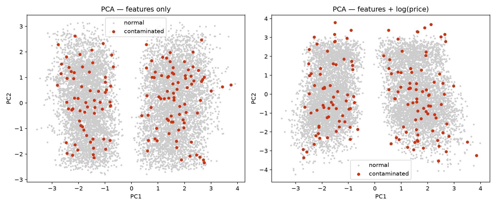
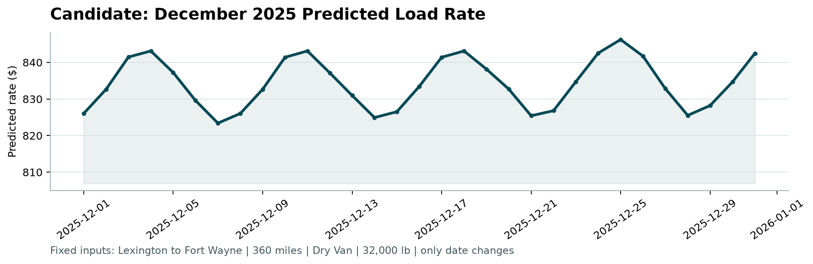

# Freight Rate Prediction

**Rana Roy** · October 2026
Spotter — Machine Learning Engineer Assessment

---

## What this project does

I was given 48,000 past freight loads. Each row says where a truck picked up,
where it dropped off, how far it went, how heavy the load was, what kind of
truck it needed, and what price was paid.

My job was to learn the price from those rows, and then set a price for 12,000
new loads where the price is hidden. I also had to draw a price chart for the
same trip across all 31 days of December.

**Result: my price is wrong by $110.67 on average, which is 4.75% off.**
A simple rule that only looks at distance is wrong by $196.95. So the model is
about 44% better than the simple rule.

---

## The short version

Five things are worth your time, even if you read nothing else:

1. **I split the data by date, not at random.** The task is to predict the
   future from the past, so my test had to work the same way.
2. **The data had errors, and I fixed them instead of deleting rows.**
3. **A tiny number of rows cause almost all of the error.** 50 rows out of
   9,523 carry 89% of it. This changes which score you should trust.
4. **Those rows are not strange loads. They are normal loads with wrong
   prices.** No model can predict them, so I made the model ignore them.
5. **The December file is missing a column that cannot be filled in honestly,
   so I trained a second model without it** rather than invent a number.

---

## Some words I use below

| word | what it means here |
|---|---|
| **row / load** | one truck trip |
| **feature** | one piece of information about a trip, like distance or weight |
| **training** | showing the model old trips so it can learn the price |
| **holdout** | trips I hid from the model, used as a fair exam |
| **MAE** | average error in dollars. Easy to read |
| **MAPE** | average error as a percent |
| **RMSE** | an error score that punishes big mistakes much harder than small ones |

---

## 1. How I split the data for testing

This is the most important decision in the whole project, so it comes first.

The real task is: **learn from January to October, then price November and
December.** So my own test has to copy that shape. If I test in a way that does
not match the real job, my score is a lie.

So I split by date:

- **Train on** 1 Jan – 31 Aug 2025 — 38,477 loads
- **Test on** 1 Sep – 31 Oct 2025 — 9,523 loads

The model learns from the first eight months, and is scored on two months it has
never seen.

**Why not split at random?** A random split would let the model learn from
October and then be tested on June. It would be reading the future to predict the
past. In real life that is impossible, and the score it gives you is too good to
be true.

One more point. After all the measuring was done, I retrained the final model on
**all 48,000 labelled rows**, January to October. The August cut existed only to
measure. Once measuring is finished, throwing away September and October would be
wasting good data for no reason.

---

## 2. Cleaning the data

| what I found | what I did |
|---|---|
| **292 weights were negative.** A truck cannot weigh minus 30,000 lbs | The sizes matched the normal rows, so it is a minus sign typed by mistake. I flipped the sign. This saved 292 rows instead of deleting them |
| **300 weights were missing** | Filled with the middle weight **for that type of truck**. A reefer and a flatbed do not carry the same loads, so one number for all three would be wrong |
| **374 market values were missing** | This number describes the whole day, not one trip. So I filled it with that day's average. A single average for the whole year would have flattened ten months into one number |
| **Duplicate rows** | None found |

All three files go through **one shared cleaning function**. This matters more
than it sounds. If training cleans the data one way and prediction cleans it
another way, the model is fed something different from what it learned on, and
nobody notices until the numbers are already wrong.

---

## 3. The prices are lopsided

Most loads are cheap and a few are very expensive. I did not assume this. I
measured it.

```
skewness     1.902      0 would mean balanced. 1.9 is a strong lean
mean      $2,373.98
median    $2,030.76     the average sits above the middle
99th %    $5,972.83
highest  $25,533.00     more than 4x the 99th percentile
```

Half of all loads cost under $2,030. The 99th percentile is $5,972. But the top
price is $25,533. So a very small group stretches far past everything else.

**What I did:** I trained the model on the log of the price instead of the price.
Log pulls the long tail back in. After the log, the lean drops from 1.902 to
−0.491, which is close to balanced.

**Why this helps:** on the normal scale, being $500 wrong on a $20,000 load
counts the same as being $500 wrong on a $600 load. But the second one is a
disaster and the first one is almost correct. Log makes the model care about
*percentage* error, which is what pricing actually cares about.

Result: average error fell from $125.67 to $118.66.

---

## 4. The main finding: a few rows cause nearly all the error

Early on I noticed something odd. My RMSE was $654 but my MAE was only $196 —
more than three times apart. RMSE squares the errors, so it blows up when a few
rows are badly wrong. Normally these two numbers are much closer. A gap this wide
means a small number of rows are *very* wrong, not that everything is a little
wrong.

So I sorted the errors and counted.

| worst rows | that is | share of total squared error |
|---|---|---|
| 10 | 0.11% of rows | **43.1%** |
| 50 | 0.53% of rows | **89.0%** |
| 100 | 1.05% of rows | 96.9% |
| 500 | 5.25% of rows | 98.8% |

**50 rows out of 9,523 carry 89% of the error.**

This explains something that confused me for a while. Across every model I tried,
my MAE improved by 44% while RMSE improved by only 3%. MAE counts all 9,523 rows
equally. RMSE is basically just those 50 rows. They were not measuring the same
thing at all.

It also explains why the log transform made RMSE slightly *worse* even though it
clearly helped everywhere else. Log stops the model from chasing extreme values —
which is the right choice for the other 99.5% of loads.

**So my recommendation is: do not judge this problem on RMSE alone.** I report
it, but MAE and MAPE are where real skill shows up.

---

## 5. What those rows actually are

Instead of guessing, I printed them and looked.

Here is one. Baltimore to Oklahoma City, 1,760 miles, 29,521 lbs, a normal dry
van. Nothing unusual about the trip at all.

```
fair price from the distance rule     $ 3,525
what my model predicted               $ 3,491
what was actually paid                $20,132
```

My model agrees with the fair price of that trip to within 1%. **The model is not
wrong. The row is wrong.** Someone was charged 5.7 times what that trip is worth.

Across the test period, **144 of 9,523 loads (1.51%) have a price like this.** 73
are far too high (typically 3.4x), and 71 are far too low (typically 0.3x). 73 up
and 71 down is almost perfectly balanced. Real life does not produce that kind of
symmetry. This looks like noise that was added to the data on purpose.

### I could not find them by looking at the trips

I tried. I drew all the test loads on a flat 2D map using PCA, and coloured the
bad ones red.



The red dots sit right on top of the grey ones. They do not form their own group.

This failure is useful, because it rules out a whole family of methods. Tools
like Isolation Forest, LOF and DBSCAN all work by finding points that sit *far
away* from the other points. These points are not far from anything. A $20,000
price looks exactly like a long, heavy, expensive trip. The problem only exists
**relative to what the trip is worth** — which is why looking at the model's
mistakes finds them, and looking at the trips themselves never will.

**The honest conclusion:** whatever explains a 5x price — a truck stuck at a
dock, a broker out of options, a phone call nobody wrote down — was never
recorded in this file. No clever feature can bring back information that is not
there.

---

## 6. What I did about it

Since those rows cannot be predicted, the answer is not a better model. The
answer is a model that refuses to be dragged around by them.

I removed training rows whose error was more than 4 units of spread away from
normal. But **which** measure of spread matters here. I did not use standard
deviation, because the bad rows *are* the huge errors — they would inflate the
standard deviation themselves and widen the very gate meant to keep them out. So
I used the **median absolute deviation**, which ignores extreme values by design.

```
spread = 1.4826 x median( | error - median error | )
```

| model | RMSE | MAE | MAPE |
|---|---|---|---|
| simple rule, distance only | 654.42 | 196.95 | 9.88% |
| gradient boosting, normal price | 634.90 | 125.67 | 5.78% |
| gradient boosting, log price | 636.89 | 118.66 | 5.20% |
| **+ bad rows removed from training** | **634.96** | **110.67** | **4.75%** |

This removed 628 of 38,477 training rows — 1.63% — and improved the average error
by 6.7%. **Deleting data made the model better.** Those rows were teaching it
noise.

One rule I kept strictly: **trimming happens on training data only.** The test
set keeps all 9,523 rows, bad prices included. If I cleaned the exam as well as
the textbook, I would be setting myself an easier test and then reporting the
score as if it were real.

---

## 7. Is November–December actually different?

I did not want to assume. I tested it.

I trained a small model whose only job was to guess whether a row came from
January–October or from November–December. I removed every date column first, so
it could not simply read the answer off the calendar. If the two periods are
really the same, this model should fail and score 0.5 — the same as a coin flip.

```
score using all features: 0.8736
```

That is far above a coin flip, so the two periods **are** different. But which
part changed? I ran the same test one feature at a time:

```
distance      0.4999        pickup latitude    0.5254
weight        0.5066        delivery latitude  0.5243
truck type    0.4970        quote signal       0.5350
market index  0.7907   <-- this one, alone, is the whole difference
```

**The loads did not change. The market did.** Every physical fact about the trips
scores at coin-flip level. November and December are simply a cheaper market: the
typical market level is 0.91, against 1.06 in training.

That sounds alarming. I checked three things, and all three say it is safe:

1. **Nothing is outside what the model has seen.** November–December market
   levels run 0.72 to 1.10. The training data runs 0.68 to 1.47. **0 of 12,000
   rows** fall outside the range the model learned on. This matters because tree
   models can fill in gaps inside a range they know, but cannot extend past the
   edge of it.
2. **The market level is handed to me.** It is a column in the validation file. I
   am never asked to forecast the market — I price a load *inside* a market level
   that is given to me. Both facts are needed together: being handed a number is
   useless if the model has never seen a number like it, and being in range is
   useless if I had to guess the number myself.
3. **My test period was already in the cheaper market.** September–October sits
   at 0.93, and November–December at 0.91. So the $110.67 error I measured was
   measured under the same market conditions the model will actually face.

**A smaller finding:** 8 cities appear in the new data that never appear in
training — Allentown, Charlotte, Chicago, Jackson, Knoxville, Laredo, Norfolk and
San Diego. This is exactly why I used latitude and longitude instead of city
names. A list built from the 64 training cities has no slot for Chicago at all. A
position on the map does: Chicago sits between places the model already knows.

---

## 8. The December chart

The December file is missing six columns. I recovered them from data I was
already given. **Nothing here is invented.**

| missing | where I got it |
|---|---|
| 4 map coordinates | a city-to-position list built from the training file. Positions never change, and both December cities appear there |
| market level | the daily average from the validation file, matched on date. It covers all 31 December days |
| quote signal | **not recovered — I removed the column instead** |

### Why I removed one column instead of filling it

Both missing columns could have been filled the same easy way: take the average
for that day. But I checked whether that is actually sensible, and for one of them
it is not.

I measured two things for each column — how much the **days** differ from each
other, and how much **loads on the same day** differ from each other.

```
                 between days    within one day
market level        0.1665           0.0248      -> belongs to the DAY
quote signal        0.1294           0.2606      -> belongs to the LOAD
```

The market level barely moves inside a single day. Everybody shipping on the 15th
is in the same market, so a daily average describes it very well.

The quote signal does the opposite. Loads on the same day differ from each other
**more** than the days differ from each other. On 15 March, across 151 loads, the
market level spread 0.14 while the quote signal spread 1.33 — nine times wider,
on one single day. A daily average would not describe it. It would just be a
guess wearing a disguise.

And here is the part that decided it: **if I fill the column with a fake number,
the model still uses it.** It learned during training that this column affects
price. So it would confidently move all 31 December prices based on a number I
made up. Removing the column means the model never looks for it at all.

**A model given a wrong input is worse than a model given fewer inputs.**

So December uses a second model, trained without that column. Slightly less
informed, but honest.

### The chart



**Prices run from $823.40 to $846.25** — a 2.77% swing across the month, in a
weekly rhythm.

```
Mon 826.72   Tue 833.63   Wed 841.86   Thu 843.91
Fri 838.57   Sat 831.52   Sun 824.82
```

It peaks on Thursday and bottoms out on Sunday. I did not build that in. The
model found it on its own from the day of the week, and it matches how freight
demand really behaves — shippers push to clear loads before the weekend.

**Is the price level right, though?** A nice shape can still sit at completely the
wrong price. So I checked against real data: this exact route appears **32 times
in the training file**, at prices from $757.93 to $973.75, with a middle price of
$848.61.

My chart sits comfortably inside that range. So the level is confirmed against
real prices that were actually paid, not just against my own model.

---

## 9. Checking the 12,000 predictions

The validation file has no prices in it, so I cannot score myself. But I can ask
whether my answers are *sensible*. If my numbers sit where real freight prices
sit, nothing is badly broken.

| point in the range | my predictions | real training prices |
|---|---|---|
| 1% | $333.32 | $327.17 |
| 25% | $1,266.69 | $1,251.55 |
| 50% | $2,038.24 | $2,030.76 |
| 75% | $3,380.50 | $3,330.75 |
| 99% | $5,811.93 | $5,972.83 |

Everything lines up, except the very top, where I sit a little below the real
data. That is expected and I believe it is correct: I deliberately stopped the
model from chasing the corrupted spikes. **If the top matched exactly, it would
mean my cleaning did nothing.**

The file also passes every format check: 12,000 rows, no blanks, no repeated IDs,
no zero or negative prices. The provided `score.py` validates both output files.

---

## 10. What I would do with more time

- **Confirm bad rows with several models, not one.** Right now a single model's
  mistakes decide which rows get removed. I would rather have three or four
  different algorithms agree a row is unexplainable before deleting it. That
  protects against deleting a row that one weak model simply failed on.
- **Measure the floor.** Work out the best score anyone could possibly get if they
  priced every normal load perfectly and were only wrong on the corrupted 1.5%.
  That tells you how much of my remaining error can even be removed.
- **Give a price range instead of one number.** Then whoever uses this can see
  which quotes are confident and which are not.

---

## How to run this

```bash
python -m pip install -r requirements.txt

python src/data.py          # loading and cleaning checks
python src/drift_check.py   # is Nov-Dec different?
python src/train.py         # split, baseline, models, error analysis
python src/predict.py       # final models, both output files

python score.py --predictions validation_predictions.csv \
                --december-predictions december-predictions.csv
```

The four provided CSVs go in `data/`. They are not committed to the repository.
